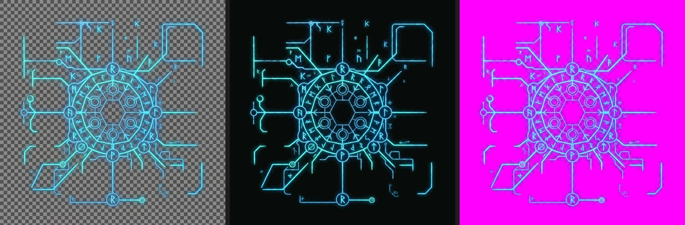
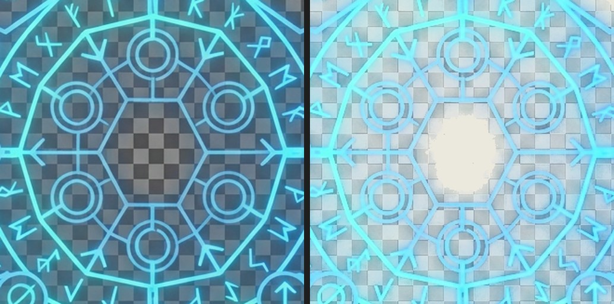

# unfake-alpha

**Real transparency for images that only *pretend* to have it.**

Image generators often hand you a "transparent" PNG whose transparency is *painted on*: a grey checkerboard baked into
the pixels. Worse, their invisible watermark nudges pixel values by a few units everywhere, which is invisible to the
eye but enough to make a magic wand or bucket fill fall apart into lacework. unfake-alpha rebuilds the checkerboard
behind every pixel, removes it, and turns soft glows into real partial transparency.


*Left: as generated, with a painted checkerboard. Middle and right: unfake-alpha's result over near-black and magenta.*

It comes three ways, all doing the same steps with the same results:

| | needs | |
| --- | --- | --- |
| `unfake_alpha.py` | Python 3, Pillow, numpy | command line; opens PNG, JPG, WebP |
| `unfake_alpha.mjs` | node 18+, nothing else | command line; PNG only (it has its own PNG reader and writer) |
| `krita/` | Krita 6 (or 5) | a Krita plugin: works on the active layer, puts the result on a new one |

## Using it

```
python unfake_alpha.py  examples/traces2.png --preview
node   unfake_alpha.mjs examples/traces2.png --preview
```

- Writes `traces2_alpha.png` next to the input (or into `--out DIR`).
- `--preview` also writes `traces2_alpha_preview.png`: the result on near-black next to it on magenta. Magenta
  because no art uses it, so anything left of the background jumps out.
- Give it a folder to do every image in it. Images that already have real transparency are skipped.
- `--bg '#000000'` (any colour) for a flat painted background instead of a checkerboard.
- `--floor 0.03`: opacity under this becomes fully transparent (see step 4).

### In Krita
1. **Install once:** Tools > Scripts > *Import Python Plugin from File...*, choose
   `krita/unfake_alpha_krita_plugin.zip`, say yes to enabling it, restart Krita.
2. Select the layer with the image, then Tools > Scripts > *Unfake Alpha (painted checker to transparency)...*.
3. Choose "Find the checkerboard" or a flat colour, and the floor.

The result goes on a new layer, `<name> (unfaked)`, above the original. The original is only hidden, never changed:
to undo, delete the new layer. It needs an 8-bit RGBA layer (Image > Convert Image Color Space if not). Krita's
built-in Python has no numpy, so the plugin does the maths in plain Python: about 2 seconds for a 1024px image.

If you change the plugin, rebuild the zip with `python krita/build_zip.py` rather than zipping it by hand: Krita's
importer finds a plugin by the zip's entry for the plugin's *folder*, which most zip libraries don't write unless asked
(the symptom is "No plugins found in archive").

## How it works

Every pixel of a layered picture is a mix:

```
seen = alpha × art + (1 − alpha) × background
```

A fake checkerboard is the generator doing that mix over a grey checker, then throwing the layers away. If we know
the background behind each pixel, we can run the equation backwards. So it's two halves: **rebuild the background**,
then **undo the mix**.

### 1. Rebuild the checkerboard
- **The greys.** Grey means red = green = blue. Coloured art rarely is, so it collects the near-grey pixels (channels
  within 10 of each other) and finds the two most common shades. In the example: 82 and 138.
- **The grid.** It marks each grey pixel light or dark, then counts, for each column, how often light meets dark
  across it. Grid lines are where that count spikes.
- **Generated checkers drift.** The example's squares are 16, 17, 16, 18 px: no single size-and-offset fits. So it
  takes the rough spacing from the rhythm of the spikes (a Fourier transform), then snaps each line to the real spike
  nearest to where it should be, falling back to the spacing only where art hides a line.
- **The rhythm echoes**, like overtones in sound: sharp edges echo at 2× and 3× their true rhythm, and an echo can come
  out loudest (a first version found 8.2px squares, half the truth). Pitch detectors have the same problem and the same
  fix: if half (or a third of) the frequency is nearly as strong, that's the real one.
- **The check.** It reports how many grey pixels the grid predicts right (100% in the example). And now it knows which
  grey sits *under* the art too, where you can't see it.

### 2. Grey pixels are background, and the watermark goes with them
Any pixel that's grey and between the two shades becomes fully transparent. This is the step that tolerance-based
selection gets wrong:
- A magic wand asks *"is this pixel within some tolerance of the colour I clicked?"* The watermark nudges pixels by a
  few units, in a pattern built to survive compression and resizing. On a flat grey that pushes pixels just over and
  just under the tolerance in a speckled pattern, and the selection follows it. The wand ends up tracing the watermark.
- unfake-alpha asks *"is this pixel grey, and between the two background shades?"* A few units of nudging doesn't turn
  grey into a colour, so the answer stays "background" whatever the watermark did.
- The principle carries over to any art program: **select by what kind of colour a pixel is, not by exactly which
  colour.** "Colour to alpha" and select-by-saturation tools work that way; a magic wand on a flat colour doesn't.

### 3. Colour to alpha on everything else
(The same idea as GIMP's tool of that name.) Each remaining pixel has two unknowns, its opacity and its true colour,
and one thing we can see, so there's no exact answer. It takes the **least opacity that still explains the pixel
with a real colour** (every channel between 0 and 255):
- brighter than its background in a channel: how far toward white is it? `(seen − bg) / (255 − bg)`
- darker: how far toward black? `(bg − seen) / bg`
- opacity is the largest of those over red, green and blue; then `art = bg + (seen − bg) / opacity` takes the
  background's share back out.

Bright cores come out nearly opaque, and faint glows come out faint and correctly coloured, so they blend over any
background with no grey fringe.

### 4. A floor
Opacity under 3% (`--floor`) goes to zero: leftover specks of watermark and compression noise.

## What it can't do

- **Soft hazes come out fainter than painted, and grainy on light backgrounds.** Step 3 takes the *least* opacity, which
  under-guesses a haze. Measured on the example: in the haze around the rune ring, the checker's contrast drops from 56
  to about 27, exactly what a 52%-opaque teal layer would do, while step 3 gives it about 25%. Over dark backgrounds you
  can't tell. Over light ones the haze is lighter than drawn, and the watermark's speckle and a faint grid show in it:

  

- **Grey art on a grey checker.** Step 2 can't tell them apart. Coloured art (glows, neon, illustrations) is the
  sweet spot.
- **Finished pictures.** If the background is part of the art (a textured board, a scene), it will try to remove it.

### An experiment that didn't make it: difference matting
The textbook fix for that haze is *difference matting* (Smith and Blinn, 1996), the principle behind photographing
something against two different backdrops. A checkerboard *is* the same art over two known backgrounds, side by side,
so comparing neighbouring squares should *measure* opacity instead of bounding it: where the art is clear, light and
dark squares differ by the full contrast; where it's opaque, they don't differ at all.

We built it two ways (comparing local averages, then each pixel with its four neighbours one square away) and both
came out worse: blotchy opacity, and the checker printed into the art's colour. On average a generator's haze follows
the layering equation (that's how the 52% was measured), but pixel by pixel it paints each square's haze a little
differently, and the watermark's jitter adds to that; per-pixel comparisons amplify it all. Right in principle, too
noisy for generated images. It might work on a clean export from an art program.

## Tests

```
python tests/check_scripts.py      # all three versions agree with each other and with examples/ (to within 1)
python tests/test_krita_plugin.py  # the Krita plugin, run outside Krita (Windows, needs Krita 6 installed)
```

The plugin test borrows Krita's own Python bindings, stands in for Krita's API with a small fake document, and runs
the plugin's menu action, dialog and progress bar on the example. Then it feeds the install zip to Krita's own
importer code (into a scratch folder).

## Credits

Made by **AM** ([agoramachina](https://github.com/agoramachina)) with **Lintel** (Claude Opus 5.5), an AI collaborator,
while preparing art for a tabletop game. Lintel wrote the code and AM brought the problem, the images and the
questions that shaped it.

The example image (`examples/traces2.png`) is AI-generated, watermark and all: exactly the kind of image this was made
for.

MIT licence: see [LICENSE](LICENSE).
